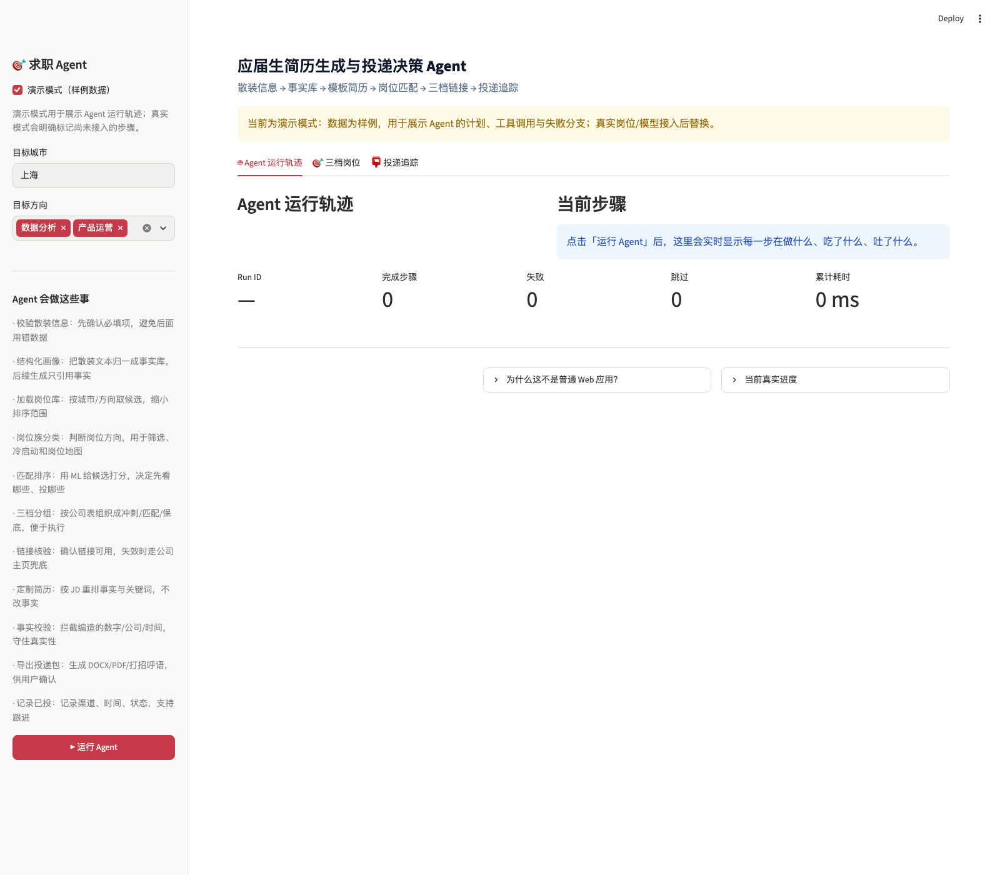
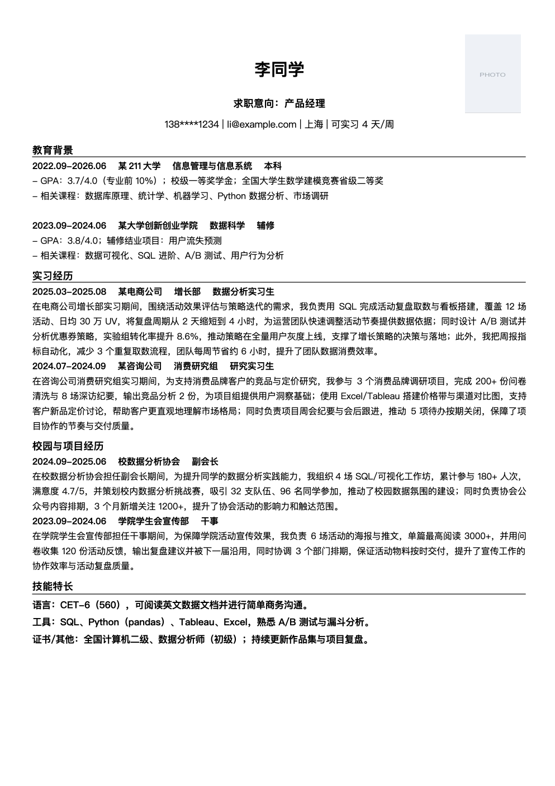

# 求职助手：简历生成与岗位决策 Agent

面向应届生的简历与投递辅助工具：把一段零散的个人介绍整理成 **教育背景 / 实习经历 / 校园与项目经历 / 技能特长** 四块内容，推荐求职方向，按方向生成一整段式简历，并给出三档岗位与投递记录。



## 1. 功能

- **对话采集**：一段话输入，自动整理四块内容，缺失项继续追问；
- **补充记忆**：后续补充只追加、不覆盖；奖学金、竞赛、技能、日期有兜底；
- **方向推荐**：根据已有经历给出 3 个方向，选定后再写细；
- **段落式简历**：每段实习/项目/校园经历写成一整段，不编造事实；
- **多段经历**：第 3 段及以后自动扩展，不固定 2 段；
- **表单填写**：粘贴一段话自动识别并填入表单；
- **模板库**：主模板可一键生成，另有 21 个代表模板可预览/下载；
- **三档岗位**：大厂/中厂/小厂岗位、链接检查、打招呼语、标记已投；
- **投递追踪**：状态、7 天跟进、漏斗与回复率；
- **处理记录**：每个板块右侧显示本步做了什么，绿色完成状态。



## 2. 快速开始

```bash
python3 -m venv .venv
source .venv/bin/activate
pip install -r requirements.txt

cp .env.example .env
# 在 .env 填入模型 API Key（不要把 .env 提交到 GitHub）

streamlit run src/app/streamlit_app.py
```

本地默认地址：`http://127.0.0.1:8502`（以终端输出为准）。

## 3. 机器学习模块

本项目包含三个从零实现（numpy）的 ML 组件，详见 [docs/ML_MODULES.md](docs/ML_MODULES.md)：

| 知识点 | 任务 | 方法 | 结果 |
|---|---|---|---|
| 监督文本分类 | 13 类岗位族分类 | TF-IDF + 多项式朴素贝叶斯 | Macro-F1 **0.7602**（规则银标准） |
| 无监督聚类 | 3,900 条岗位分群 | TF-IDF + spherical K-Means++ | k=13，轮廓系数 0.0656 |
| 特征工程 + 学习排序 | 简历–岗位排序 | 7 维特征 + L2 逻辑回归 | NDCG@5 **0.8543** vs 基线 0.5839（弱标注） |

复现：

```bash
# 指定一个已安装 numpy 的 Python
PYTHON_BIN=python3 bash scripts/train_all_ml.sh
```

指标写入 `experiments/results/`，模型写入 `models/`。

> 注意：分类标签来自岗位族规则，排序标签是弱标注；两者都不是人工金标准，报告里不能把它们当作真实业务泛化结论。

## 4. Skills

两个自建 Skill：

- `skills/resume-section-extractor/`：杂乱文本 → 四段 JSON；
- `skills/resume-direction-tailor/`：四段画像 + 方向 → 段落式简历。

运行时读取的是各自目录下的 `prompt.md`；`SKILL.md` 和 `schema.json` 是配套说明/契约文档。来源与候选评估见 [skills/README.md](skills/README.md)。

## 5. 数据与模板

- 岗位语料：3,900 条，13 类 × 300；带链接演示岗位 30 条；
- 链接检查：29 条可直接打开、1 条需登录；
- 模板：从 497 份 DOCX 体检，主模板单页单栏；仓库保留 3 个可填充版本 + 21 个代表模板；
- 原始 1G 岗位库、291M 全量模板、个人画像/导出文件**不进入仓库**。

数据来源与许可见 [data/sources.md](data/sources.md)、[THIRD_PARTY.md](THIRD_PARTY.md)。

## 6. 目录

```text
.
├── src/
│   ├── app/            # Streamlit 页面
│   ├── agent/          # 信息整理、方向、段落整理、事件
│   ├── ml/             # 分类 / 聚类 / 排序
│   └── render/         # DOCX 模板填充
├── scripts/            # 数据、训练、生成脚本
├── skills/             # 两个自建 Skill
├── templates/          # 可填充模板 + 模板库 + 预览
├── data/               # 岗位演示数据、实验数据
├── models/             # 分类/聚类/排序模型
├── experiments/results # 指标 JSON
├── docs/               # 方法、实验、数据、部署说明
├── examples/           # 虚构示例画像/简历
├── netlify/            # Netlify 入口页
└── DEPLOY.md           # 部署步骤
```

## 7. 部署

不能把 Streamlit 直接放在 Netlify 上运行；本项目采用：

```text
Netlify 入口页  →  Streamlit Cloud 应用
```

详见 [DEPLOY.md](DEPLOY.md)。

## 8. 已知限制

- 云端免费文件系统是临时的：画像、导出简历、投递记录在应用重启后可能丢失；
- 分类是规则银标准，排序是弱标注，尚未完成人工金标准与人工相关性标注；
- 仓库只保留 21 个代表模板，不是 497 个全量模板；
- 简历生成默认一页；经历很多时会到第 2 页，不为了页数删除内容。

## 9. 许可

代码采用 MIT License，见 [LICENSE](LICENSE)。数据、模板和第三方组件的许可见 [THIRD_PARTY.md](THIRD_PARTY.md)。
