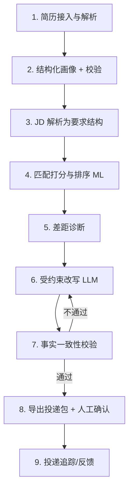

# 《机器学习》期末项目：要求解读与「简历生成与投递 Agent」方案分析

> 依据：工作区 `2026-机器学习期末报告题目及评分标准-新.docx`
> 截止时间：**2026-11-27**（今天 11-23，剩余约 4 天）
> 结论先行：**选题成立，但必须把重心从「生成简历」移到「人岗匹配排序 + 可核验的定制投递」；形态选 Web；不做真实自动投递。**

---

## 0. 三个先要认清的判断

### 0.1 时间是最硬的约束

4 天要同时完成：可运行原型、ML 实验、标注、消融、3000–5000 字报告、PDF、仓库、演示录屏。**不可能按「先做完美系统再写报告」的顺序推进**，必须从第一天就同时产出「可写进报告的证据」。

因此下面的方案默认是「最小可信闭环」：一个 ML 核心（匹配排序）+ 一条完整 Agent 工作流 + 一套能跑出数字的实验，其余全部砍掉或降级。

### 0.2 「简历生成」是高风险选题，必须换叙事

评分标准原文明确：

> 避免只做通用聊天界面或仅展示模型回答。
> 单纯调用通用大模型 API 不足以满足此项。

如果项目的核心是「把简历丢给大模型，让它改写」，那么：

- **机器学习方法与课程关联（20 分）**几乎拿不到分；
- **Agent 设计与可运行性（20 分）**会被视为「一次 API 调用 + 一个输入框」；
- 在「需改进」档的描述里，正好对应「主要为概念描述或通用模型对话，机器学习方法与任务关系不清」。

**正确的叙事**：这是一个**人岗匹配与投递决策 Agent**——ML 负责「这份简历和这个岗位有多匹配、该先投哪个、差在哪」，LLM 只负责「按匹配结果和差距做受约束的改写与解释」。简历生成是**执行环节**，不是项目核心。

### 0.3 「投递」不能做成真实自动投递

BOSS 直聘、前程无忧、智联、实习僧等平台：无公开投递 API、有验证码与风控、用户协议普遍禁止自动化操作，且自动提交会把个人隐私数据批量传给第三方。**真实自动投递 = 账号封禁 + 合规风险 + 无法复现的演示**，对课程项目是负资产。

**建议边界**：Agent 产出「投递包 + 优先级队列 + 渠道链接 + 一键复制打招呼语」，**最后一步由人点击确认**。这既符合评分标准里的「必要的人工确认」「高影响结果」，也天然是一个可写的安全设计点。若要演示端到端提交，做一个**本地 mock ATS 接口**，并在报告中明确标注「模拟投递，非真实平台」。

---

## 1. 作业硬性要求清单（逐条可核查）

下表把原文要求拆成「必须有」的交付物。**每一项都要能在报告或仓库里指到具体位置**，否则就是空话。

| # | 类别 | 硬性要求 | 最低可核查交付 | 评分项 |
|---|---|---|---|---|
| 1 | 选题 | 清楚的目标用户、具体痛点、可观察的任务结果 | 需求调研记录（5 位同学访谈 + 自己投递过程记录） | 需求 15 |
| 2 | 选题 | 至少一个可验证的成功标准，并说明如何采集/构造评估样例 | 指标定义表 + 标注规范 + 测试集文件 | 需求 15 / 实验 20 |
| 3 | 选题 | 明确 ML 课程内容的位置（分类/回归/聚类/推荐/文本/检索排序/评估等） | 方案图 + 方法章节 | ML 20 |
| 4 | Agent | 可运行的端到端原型（脚本/网页/桌面/框架均可） | 一条命令启动 + 演示录屏 | Agent 20 |
| 5 | Agent | 任务入口：输入、输出、成功判定 | 首页输入表单 + 输出样例 + 判定规则 | Agent 20 |
| 6 | Agent | 任务流程：拆解/执行，提示词、规则、状态管理、规划、多轮，每步说明作用 | 状态机图 + 每步日志 | Agent 20 |
| 7 | Agent | 至少一个课程相关 ML 环节，说明输入、输出、训练/推理、对任务的贡献 | 模型卡 + 训练脚本 + 指标 | ML 20 |
| 8 | Agent | 至少一个数据源/检索组件/可调用工具，交代来源、许可/隐私、边界 | 数据卡 + 许可证表 | Skills 15 / 报告 10 |
| 9 | Agent | 失败与安全：无答案、低置信度、输入异常、工具失败、高影响结果 | 异常处理表 + 安全测试样例 | Agent 20 |
| 10 | Agent | 可复现：运行说明、依赖、配置示例、测试样例、代码；密钥不入库 | README + requirements + .env.example + tests | 报告 10 |
| 11 | Skills | 列出复用组件名称、版本/commit、链接、许可证、用途，注明自写/配置/修改/复用 | 复用清单表（PDF 附录） | Skills 15 |
| 12 | Skills | 至少深入分析一个复用 skill：子任务、输入输出、权限/外部依赖、限制、如何核验 | 独立小节（≥1 页） | Skills 15 |
| 13 | Skills | 集成适配：改提示词/参数、加校验、连工具、异常处理、补测试、按评估换组件 | diff/commit + 说明 | Skills 15 |
| 14 | Skills | 消融或对照展示复用组件的实际贡献 | 消融实验表 | 实验 20 |
| 15 | 实验 | 代表性测试集：数量、来源、筛选规则、数据划分；不只展示成功案例 | 测试集说明 + 边界案例 | 实验 20 |
| 16 | 实验 | 合理基线：人工/原流程、无 Agent 模型、简化流程、基础模型、去掉某 skill | 基线对比表 | 实验 20 |
| 17 | 实验 | 至少一个定量指标 + 错误案例/定性分析；不要单一准确率掩盖关键错误 | 指标表 + 错误分类 | 实验 20 |
| 18 | 实验 | 好在哪/差在哪、错误来源、一项有证据的改进、未解决限制 | 误差分析章节 | 实验 20 |
| 19 | 实验 | 至少一次完整运行，截图/录屏能看出输入、关键步骤、最终结果 | 录屏 + 截图 | 实验 20 |
| 20 | 报告 | 3000–5000 字，含 8 个指定部分，≥5 条可靠参考文献 | PDF | 报告 10 |
| 21 | 提交 | ①报告 PDF ②代码仓库（README/依赖/步骤）③演示材料或原型 ④复用清单与许可证/来源说明（PDF 附录） | 四项齐全 | 报告 10 |
| 22 | 提交 | 文件名「学号_姓名_项目名称」 | 按格式命名 | 报告 10 |
| 23 | 诚信 | 说明生成式 AI 参与环节并核验；能解释设计与代码；不伪造数据/不隐瞒复用/不侵犯隐私 | 报告「AI 使用说明」小节 | 报告 10 |

> 注意第 22 条：**提交物文件名**也要按「学号_姓名_项目名称」。代码仓库名同样建议一致，避免最后手忙脚乱。

---

## 2. 评分表拆解：分数到底在哪里

| 评分项 | 分值 | 拿分关键 | 本项目的对应策略 | 目标 |
|---|---|---|---|---|
| 需求价值与问题定义 | 15 | 需求来自具体场景；痛点、范围、成功标准明确 | 你自己就是用户 + 5 位同学访谈 + 投递耗时/回复率记录 | 12–13 |
| 机器学习方法与课程关联 | 20 | 方法有依据；数据处理正确；说明作用；有基线/比较 | 简历–JD 匹配排序（TF-IDF/BM25 → 逻辑回归 → LambdaRank）；技能词典特征 | 16–17 |
| Agent 设计与可运行性 | 20 | 流程清楚；模型/工具/数据有效；能完成任务；异常处理/人机协作 | 8 步状态机 + 人工确认 + 事实校验 + 失败降级 | 16–17 |
| Skills 复用与工程整合 | 15 | 来源/版本/许可证完整；能解释；有实质改造；核验行为 | 复用清单 + BGE 深挖 + 适配改造 + 消融 | 12–13 |
| 实验评估与结果分析 | 20 | 测试可信；指标适当；可复核；有对照/消融/失败案例 | 150 对标注 + 留一简历交叉验证 + 4 组基线 + 4 组消融 | 16–17 |
| 报告、复现与学术规范 | 10 | 结构清晰；代码/步骤完整；引用规范；隐私/许可/归属清楚 | 模板化写作 + README + 许可证附录 | 8–9 |

**策略结论**：

1. **ML + 实验 = 40 分，是主战场。** 宁可 UI 丑一点，也要把排序实验做扎实。
2. **Skills 15 分是「文档分」**，只要清单、版本、许可证、深挖、改造、消融六件事都写清楚，性价比极高。
3. **需求 15 分需要「现场证据」**，今天就去访谈同学、记录自己投递一份简历要多久。这个证据后面无法补造。
4. **Agent 20 分的关键不是功能多，而是「跑通 + 有异常处理 + 有人工确认」**。一个稳定跑通的 8 步流程，胜过 20 个半成品功能。

---

## 3. 选题评估：为什么成立，以及必须避开的坑

### 3.1 与评分标准的对齐

| 评分维度 | 本项目的对应 |
|---|---|
| 真实需求 | 大四秋招/春招：一份简历投所有岗位、不知道投什么、投了没回音、定制一份要 30–60 分钟 |
| 目标用户 | 应届本科生/硕士生（泛互联网、数据分析、运营、产品等岗位） |
| 可观察结果 | 定制一份简历的耗时、Top-5 推荐岗位的人工相关率、改写事实错误率、人工采纳率 |
| Agent 适配性 | 多步骤、需调用工具（解析/检索/排序/导出）、需人工确认、有明确失败模式 |
| ML 落点 | 检索排序（课程明确列出）、文本表示、分类/回归、聚类、模型评估 |
| 可复现 | 全部本地可跑；LLM 可用 API 或本地模型替换；数据脱敏后随仓库提供样例 |

### 3.2 三个必须避开的坑

**坑一：把「生成」当核心。**
对照评分表，「仅展示模型回答」直接被归入「需改进」。必须让 ML 排序结果**决定**生成什么、生成多少、投哪个岗位。也就是说：**排序是大脑，生成是手**。

**坑二：预测「录取率/面试率」。**
没有真实标签，硬造一个「面试概率 73%」既不可信也不学术。**改成「匹配度」**：定义为「该岗位是否值得投递」的相关性等级（0–3），由人工按明确标准标注。这样指标可复核，也避免虚假精确。

**坑三：数据来源不清。**
爬取招聘网站 JD 可能违反 robots/用户协议；同学简历含隐私。**做法**：JD 用公开可访问的企业招聘页/高校就业网/公开数据集；简历由本人和同学**书面授权**并脱敏；报告中写清来源、筛选规则、许可证、脱敏方式。

### 3.3 一句话重新定位

> **「面向应届生的人岗匹配与定制投递 Agent：用排序模型决定投什么，用受约束的生成改写简历，用人工确认守住真实性底线。」**

这个定位同时满足：真实需求、ML 核心、Agent 工作流、安全设计、可评估。

---

## 4. 系统设计

### 4.1 用户、场景与成功标准

**Persona**：小 J，大四，数据/产品方向，秋招投了 40 家，回复 3 家；每改一版简历 40 分钟；不知道自己「差在哪」；投递记录散在 Excel 和聊天框里。

**JTBD**：当我看到一个岗位时，我想在 5 分钟内知道「我该不该投、差什么、怎么改」，并留下一份可追踪的投递记录。

**成功标准（必须可测量）**：

| 指标 | 定义 | 目标 | 测量方法 |
|---|---|---|---|
| 单份定制简历耗时 | 从上传 JD 到导出可投简历 | ≤ 8 分钟（原流程约 40 分钟） | 3 次计时，录屏 |
| Top-5 相关率 | 推荐前 5 个岗位中人工判定「值得投」（≥2 分）的比例 | ≥ 0.8 | 测试集标注 |
| 改写事实错误率 | 生成内容中出现原文不支持的事实（数字/公司/时间/职责）的比例 | ≤ 2% | 人工逐条核查 50 条 |
| 人工采纳率 | 用户接受或小改后接受的改写条目占比 | ≥ 60% | 3 位同学试用记录 |
| 任务完成率 | 10 个端到端任务中成功产出完整投递包的比例 | ≥ 90% | 测试脚本 |

> 报告中要写清「目标值」是设计目标，不是已达成；实际值放实验结果。

### 4.2 任务入口

**输入**：

- 简历：PDF / DOCX（也支持粘贴文本）
- 求职意图：目标岗位族（如「数据分析」「产品运营」）、城市、期望薪资、到岗时间、是否接受实习
- 岗位来源：上传 JD 文本，或从内置 JD 库中检索

**输出**：

1. 匹配排序列表（分数 + 匹配证据 + 缺失项）
2. 差距诊断报告（硬性条件 / 技能 / 经历 / 关键词）
3. 定制简历（DOCX + PDF，ATS 友好）
4. 打招呼语（≤100 字，可复制）
5. 投递优先级队列 + 渠道链接
6. 投递追踪看板（状态：待投/已投/笔试/面试/拒绝）

**成功判定**：上述 6 项全部生成且通过校验（简历非空、无未支持事实、分数在 [0,1]、至少 1 个岗位进入队列）。

### 4.3 Agent 工作流（8 步状态机）



| 步骤 | 作用 | 关键技术 | 失败处理 |
|---|---|---|---|
| 1 解析 | 从 PDF/DOCX 抽文本、分节 | pdfplumber / python-docx | 解析失败 → 提示粘贴文本 |
| 2 画像 | 抽取教育、技能、经历、项目、时间 | LLM + JSON Schema + 技能词典 | 字段缺失 → 标记待确认，不猜 |
| 3 JD 解析 | 拆「硬性要求/加分项/职责」 | LLM + 规则（学历、年限、城市） | JD 过短 → 标记低信息量 |
| 4 匹配排序 | 输出相关性分数与排序 | **ML 核心**（见 4.4） | 低置信度 → 转人工 |
| 5 差距诊断 | 对比 must-have 覆盖率，给 3–5 条差距 | 词典 + 规则 + 排序特征 | 无差距 → 提示「可直投」 |
| 6 改写 | 按 JD 重排要点、STAR 化、加关键词 | LLM，严格约束「只能重组已有事实」 | 超时/失败 → 重试 2 次后回退模板 |
| 7 事实校验 | 拦截编造的数字、公司、职责 | 规则（数字/实体回查）+ LLM 判别 | 不通过 → 回退并标注 |
| 8 导出/确认 | DOCX/PDF、打招呼语、队列 | python-docx、模板 | 导出失败 → 保留 Markdown |
| 9 追踪 | 状态看板、跟进提醒 | SQLite | — |

**设计要点**：状态机而非自由对话。每一步有明确输入输出和失败分支，才能在报告里说清「这一步的作用」，也才能做消融。

### 4.4 机器学习组件（核心，20 分）

#### 任务定义

给定简历 $r$ 与岗位 $j$，输出相关性等级 $\hat{y}\in\{0,1,2,3\}$ 或连续匹配分，并据此排序。

- 3 = 强匹配，优先投
- 2 = 可投，需小改
- 1 = 弱匹配，需大改或不太可能
- 0 = 不匹配

**这不是「录取概率」**，是「值不值得投」的相关性判断。报告里必须写清这个区别，避免虚假精确。

#### 为什么选「检索排序」

1. 课程「可选的机器学习模块」明确列出「检索排序」；
2. 评估天然可做：有 query（简历）、doc（JD）、相关性标注，能算 NDCG/Recall；
3. 有清晰基线：BM25、TF-IDF、向量相似度；
4. 能做消融：去掉技能特征、去掉语义特征、去掉学习排序；
5. 直接支撑 Agent 的核心决策（投哪个），不是外挂 demo。

#### 特征设计（每对简历–岗位）

| 类别 | 特征 | 说明 |
|---|---|---|
| 词法 | TF-IDF 余弦（词级） | jieba 分词 + 停用词 |
| 词法 | 字符 3-gram 余弦 | 抗分词错误、抓技能缩写 |
| 检索 | BM25 分数 | rank_bm25，作为强基线 |
| 语义 | BGE 向量余弦 | `BAAI/bge-small-zh-v1.5`（MIT） |
| 技能 | must-have 技能覆盖率 | 技能词典 + 同义词归一 |
| 技能 | nice-to-have 覆盖率 | 同上，权重较低 |
| 硬性 | 学历是否满足 | 规则 |
| 硬性 | 专业是否相关 | 专业大类映射 |
| 硬性 | 城市/到岗时间是否匹配 | 规则 |
| 经历 | 实习/项目时长 | 从画像抽取 |
| 经历 | 量化成果比例 | 含数字的 bullet 占比 |
| 岗位 | JD 长度、must-have 数量 | 控制岗位自身信息量 |
| 简历 | 分节完整度、bullet 数 | 简历质量 |

约 15–20 维，规模小、可解释，适合 4 天。

#### 模型与训练

- **主模型**：逻辑回归（L2），输出校准后的匹配分；系数可直接解释「为什么推荐」。
- **对比模型**：LightGBM LambdaRank（学习排序），验证「排序学习是否比逐对分类更好」。
- **小样本策略**：10 份简历 × 15 个岗位 = 150 对；**留一简历交叉验证**（每次留 1 份简历的全部岗位对作测试），报告均值 ± 标准差。
- **类别不平衡**：0/1 多、3 少；用 class_weight 或分层抽样，报告中说明。
- **推理**：对新简历实时算特征 → 打分 → 排序；单次 < 1 秒（不含 LLM）。

#### 辅助 ML（可选，不建议主推）

- **JD 聚类**：对 JD 向量做 K-Means，用轮廓系数选 k，产出「岗位地图」，用于「我不知道投什么」的探索场景。工作量小、可视化好看，但**不能替代主排序实验**。
- **简历质量分类**：多标签（缺量化/缺项目/格式混乱），可用规则 + 小模型，作为改写前的诊断。优先级低。

#### 生成侧的可核验性（不是 ML，但要评估）

- 事实一致性校验：数字、公司名、时间、职位名必须在原文出现；LLM 判别「该句是否被原文支持」。
- 评估：50 条改写，人工标「支持/不支持/部分支持」，算错误率。这是安全设计，也是实验的一部分。

### 4.5 数据与工具

| 组件 | 用途 | 来源/许可 | 备注 |
|---|---|---|---|
| 中文 JD 语料 300–500 条 | 检索库、排序候选 | 公开企业招聘页/高校就业网；逐条记录 URL 与抓取日期 | 遵守 robots；不爬需登录平台 |
| 脱敏简历 10–15 份 | query、标注 | 本人 + 同学书面授权 | 姓名/电话/邮箱/学校脱敏 |
| Kaggle Resume Dataset | 补充英文简历、验证解析/分类 | CC0（[转换版说明](https://huggingface.co/datasets/opensporks/resumes)） | 英文为主，不能直接当中文标注 |
| Tianchi 招聘数据集 | 可选中文 JD 补充 | 需核对数据集页面许可 | 使用前确认条款 |
| `BAAI/bge-small-zh-v1.5` | 语义向量 | MIT（[模型卡](https://huggingface.co/BAAI/bge-small-zh-v1.5)） | 512 token 截断，长 JD 需分块 |
| jieba | 中文分词 | MIT | — |
| rank_bm25 | BM25 基线 | Apache-2.0 | — |
| scikit-learn | LR、指标、聚类 | BSD-3 | — |
| LightGBM | LambdaRank | MIT | — |
| pdfplumber / python-docx | 解析/导出 | MIT | — |
| Streamlit 或 FastAPI | Web 界面 | Apache-2.0 / MIT | 见 4.7 |
| DeepSeek / Qwen API | 画像抽取、改写、校验 | 商用条款，需核对 | 密钥只放 `.env` |

> **许可证核对原则**：表中「需核对」的项，提交前逐条打开数据集页面确认；报告附录写「名称 + 版本/commit + 链接 + 许可证 + 用途 + 自写/复用」。

### 4.6 失败与安全处理

| 场景 | 处理 | 报告中如何证明 |
|---|---|---|
| 简历解析失败/乱码 | 提示粘贴文本；不进入后续步骤 | 异常测试样例 |
| 关键字段缺失（学历/毕业时间） | 标记「待确认」，不推断 | 截图 |
| JD 信息过少 | 标记「低信息量」，降低推荐权重 | 日志 |
| 匹配分处于中间区间（低置信度） | 显示「证据不足，建议人工判断」，不硬推 | 阈值规则 + 测试 |
| 生成内容含未支持事实 | 拦截、回退、要求确认 | 事实校验日志 |
| LLM 超时/限流 | 重试 2 次，指数退避，回退模板 | 日志 |
| 导出失败 | 保留 Markdown 版本 | 测试 |
| 投递（高影响） | **绝不自动提交**，人工确认后才生成投递包 | 设计说明 + 演示 |
| 隐私 | 本地脱敏后再调 API；原始简历不离开本机；报告不含真实 PII | 脱敏脚本 + 数据卡 |

### 4.7 形态选择：Web 还是移动端？

**建议：Web（桌面优先，响应式），不做原生 App。**

理由：

1. **任务本身适合大屏**：上传简历、左右对照 JD、看 diff、审阅改写、导出 PDF，手机上体验很差。
2. **演示与评分友好**：评分者打开链接即可；截图/录屏清晰；仓库里一个 `streamlit run` 就能跑。
3. **4 天工期**：移动端要处理打包、适配、上架/安装，纯属负收益，评分表也没有「移动端」加分项。
4. **合规**：移动端更容易被理解为「自动投递 App」，而自动投递本身不建议做。

**具体建议**：

- MVP：Streamlit 单页应用（上传 → 画像确认 → 岗位列表 → 匹配详情 → 改写 diff → 导出），1–2 天可完成。
- 若想兼顾「作品集」：用 FastAPI 暴露 `/match`、`/tailor`、`/export` 接口，前端先用 Streamlit；时间够再换 React。**不要为 UI 牺牲实验。**
- 可选亮点：PWA，手机端只读「投递追踪看板」，不做编辑。

### 4.8 技术架构（建议）

```
前端 Streamlit
   │
FastAPI（可选，若做前后端分离）
   │
Agent 编排层（状态机，Python）
   ├── 解析器 pdfplumber / python-docx
   ├── 画像抽取 LLM + JSON Schema
   ├── 匹配排序 scikit-learn / LightGBM + BGE
   ├── 差距诊断 技能词典 + 规则
   ├── 改写 LLM（受约束）
   ├── 事实校验 规则 + LLM
   └── 导出 python-docx / PDF
   │
SQLite（投递追踪） + 本地文件（简历/JD）
```

---

## 5. 实验与评估方案（20 分，决定上限）

### 5.1 测试集构造

- **规模**：10–12 份简历 × 每份 12–15 个岗位 ≈ 150 对。
- **来源**：本人和同学的真实简历（脱敏）+ 自采 JD。
- **筛选规则**：岗位覆盖 3–4 个方向（数据分析、产品、运营、后端），每个方向 mix 高/中/低匹配；避免全是「明显不匹配」的简单样本。
- **标注**：0–3 四级，写清 rubric（硬性条件、技能覆盖、经历相关度、成长性）。**2 人独立标 30 对算 Cohen's κ**，κ < 0.6 就修订 rubric。
- **划分**：留一简历交叉验证（按 query 划分，防止同一简历的岗位对泄漏到训练集）。
- **边界案例**：跨专业、无实习、JD 只有一句话、技能同义词（「数据分析」vs「BI」）、过度匹配（overqualified）、英文 JD。

### 5.2 基线

| 基线 | 说明 |
|---|---|
| B0 人工原流程 | 自己按经验挑岗位，记录耗时与选择 |
| B1 BM25 | 纯检索，无学习 |
| B2 TF-IDF 余弦 | 经典文本相似度 |
| B3 BGE 向量余弦 | 纯语义 |
| B4 逻辑回归（全特征） | 主模型 |
| B5 LightGBM LambdaRank | 排序学习对比 |
| B6 去掉 LLM 的模板改写 | 生成侧对照 |

### 5.3 指标

| 指标 | 用途 |
|---|---|
| NDCG@5 / NDCG@10 | 排序质量（主指标） |
| Recall@5 | 前 5 是否覆盖「值得投」的岗位 |
| MRR | 第一个高相关岗位的位置 |
| 人工采纳率 | 改写可用性 |
| 事实错误率 | 安全性 |
| 单份耗时 | 效率（对比原流程） |
| 单份成本 | API token 费用 |

> 不要只报 accuracy。排序任务里 accuracy 会被大量 0/1 样本稀释，必须报 NDCG/Recall。

### 5.4 消融实验

| 消融 | 验证什么 |
|---|---|
| 去掉技能词典特征 | 领域知识（同义词归一）的贡献 |
| 去掉 BGE 语义特征 | 语义表示的贡献 |
| 去掉学习排序（只用 BM25） | ML 模型本身的贡献 |
| 去掉事实校验 | 安全性对错误率的影响 |
| 去掉 LLM（模板改写） | LLM 在生成侧的边际价值 |

每组报告均值 ± 标准差，并给 1–2 个具体案例。

### 5.5 错误分析（必须有）

按来源分类，每类给例子：

- 数据：JD 太短/太泛、简历信息缺失
- 表示：技能同义词未归一、长文本被 512 token 截断
- 模型：小样本过拟合、类别不平衡
- 提示词：改写过度、丢失量化数字
- 工具：PDF 解析丢表格、导出格式错
- 任务设计：把「可培养」误判为「不匹配」

最后写「一项有证据的改进」+「仍未解决的限制」。

### 5.6 演示

- 录屏 3–5 分钟：输入简历 → 画像确认 → 排序结果 → 差距 → 改写 diff → 事实校验拦截一次 → 导出 → 追踪看板。
- 至少演示一次**失败/低置信度**分支，证明异常处理不是摆设。
- 截图放进报告（输入、关键步骤、最终结果三张以上）。

---

## 6. Skills 复用与深挖（15 分）

### 6.1 复用清单（示例，最终以实际使用为准）

| 组件 | 版本 | 许可证 | 用途 | 自写/复用/改造 |
|---|---|---|---|---|
| `BAAI/bge-small-zh-v1.5` | 需记录 commit | MIT | 语义向量特征 | 复用 + 分块适配 |
| `rank_bm25` | 需记录 | Apache-2.0 | BM25 基线 | 复用 |
| `jieba` | 需记录 | MIT | 分词 | 复用 + 自定义词典 |
| `scikit-learn` | 需记录 | BSD-3 | LR/指标/聚类 | 复用 |
| `LightGBM` | 需记录 | MIT | LambdaRank | 复用 + 调参 |
| `pdfplumber` | 需记录 | MIT | PDF 解析 | 复用 + 表格处理 |
| `python-docx` | 需记录 | MIT | DOCX 导出 | 复用 + 模板 |
| Streamlit | 需记录 | Apache-2.0 | Web UI | 复用 |
| DeepSeek API | 模型版本 | 商用条款 | 抽取/改写/校验 | 调用 + 提示词/校验改造 |

### 6.2 深挖对象建议：BGE 中文向量模型

报告里至少写清：

- **解决什么子任务**：把简历段落和 JD 映射到同一向量空间，补足词法匹配抓不到的语义相似（如「用户增长」vs「拉新」）。
- **输入输出**：文本（≤512 token）→ 512 维向量；中文支持较好；需 `query:` 前缀（按模型卡要求）。
- **依赖与权限**：从 HuggingFace 下载权重（约百 MB），本地推理，无需外部账号；首次运行需联网。
- **限制**：512 token 截断（长 JD 会丢尾部要求）；对否定句、数字条件不敏感；同义词/缩写仍可能失配；CPU 推理有延迟。
- **如何核验**：构造 20 组「同义/不相关」句对，检查相似度排序；对比 BGE 与 TF-IDF 在 150 对标注上的 NDCG；记录截断前后的差异。
- **改造**：长 JD 分块取最大/平均；技能词归一后再拼接；把相似度作为特征而非最终分数。

> 这一段直接对应「至少深入分析一个所复用的 skill」，也是 Skills 15 分里最容易拿满的部分。**不要写成 README 摘要**，要写你实际测到了什么。

### 6.3 集成适配（要能指出 commit/diff）

- 给 jieba 加 200 个技能词，避免「大模型」被切碎；
- BGE 长文本分块 + 池化；
- 排序分数做 Platt/isotonic 校准，才能当「置信度」用；
- 事实校验加规则白名单（数字、公司、时间）；
- LLM 输出强制 JSON Schema，失败重试；
- 用评估结果决定「LR vs LambdaRank」。

---

## 7. 交付物与仓库结构

```
resume-agent/
├── README.md                 # 运行步骤、依赖、演示、目录说明
├── requirements.txt
├── .env.example              # 只放变量名，不放密钥
├── LICENSE
├── data/
│   ├── jd/                   # JD 文本 + 来源清单（URL/日期/许可）
│   ├── resumes_sample/       # 脱敏样例
│   └── annotations/          # 150 对标注 + rubric
├── src/
│   ├── parse/                # PDF/DOCX 解析
│   ├── profile/              # 画像抽取 + schema
│   ├── features/             # 特征工程
│   ├── rank/                 # 训练/推理/评估
│   ├── generate/             # 改写 + 事实校验
│   ├── export/               # DOCX/PDF
│   └── app/                  # Streamlit/FastAPI
├── experiments/
│   ├── run_baselines.py
│   ├── run_ablation.py
│   └── results/              # csv + 图
├── tests/                    # 至少 10 个测试样例
├── docs/
│   ├── 复用组件清单与许可证.pdf
│   └── 演示录屏.mp4
└── report/
    └── 学号_姓名_项目名称.pdf
```

**README 必含**：一句话简介、架构图、安装、启动、数据准备、复现实验命令、已知限制、许可证、AI 使用说明。

---

## 8. 报告结构（3000–5000 字，按评分项对齐）

| 章节 | 建议字数 | 必须回答的问题 |
|---|---|---|
| 封面 | — | 项目名、课程、姓名/学号、分工、日期 |
| 1 需求与目标 | 600 | 谁、什么场景、什么困难、现有做法哪里差、成功标准 |
| 2 方案与系统设计 | 800 | 工作流、模型/工具/数据关系、关键取舍与备选 |
| 3 机器学习方法 | 900 | 数据处理、特征、模型、训练/推理、基线、如何支撑任务 |
| 4 Skills 与组件复用 | 700 | 来源/版本/许可/用途、深挖一个、集成改造、行为核验 |
| 5 实验设计与结果 | 1000 | 测试集、指标、基线、消融、失败案例、误差分析 |
| 6 讨论与改进 | 500 | 真实价值、风险边界、局限、后续 |
| 7 参考文献与附录 | — | ≥5 条可靠来源；代码/运行/依赖/测试；许可证清单 |
| 8 AI 使用说明 | 150 | 用了什么工具、参与哪些环节、如何核验 |

> 字数按「正文」算，图表/代码/参考文献不计。**先写实验部分**，因为数字是写出来的，不是最后编出来的。

---

## 9. 四天冲刺计划（11/23–11/27）

| 时间 | 任务 | 产出（当天必须落盘） |
|---|---|---|
| **11/23 晚** | 冻结范围；访谈 3–5 位同学；记录自己投一份简历的耗时；定标注 rubric；建仓库骨架 | 需求记录、rubric、repo、数据采集脚本 |
| **11/24** | 采集 300+ JD；解析 PDF/DOCX；画像 Schema；技能词典 200 词；开始标注 40 对 | 解析通过的 10 份简历、JD 库、40 对标注 |
| **11/25** | 特征工程；LR + BM25/TF-IDF/BGE 基线；评估脚本；Agent 状态机 1–6 步；Streamlit 首版 | 基线结果表、可跑通的排序 Demo |
| **11/26** | 改写 + 事实校验 + 导出；补完 150 对标注；跑消融；录屏；报告初稿 | 完整端到端、实验表、报告 v1、录屏 |
| **11/27** | 报告定稿/PDF；README/许可证附录；仓库整理；按命名提交；留 3 小时 buffer | 四项提交材料齐全 |

**如果时间不够，按此顺序砍**：JD 聚类 → PWA → FastAPI 分离 → UI 美化 → 英文数据。**绝不砍**：排序实验、基线、消融、事实校验、README。

---

## 10. 风险登记

| 风险 | 概率 | 影响 | 规避 | 降级 |
|---|---|---|---|---|
| 中文 JD 数据不足 | 高 | 高 | 今天就开采集；公开页面 + 天池；记录来源 | 缩小到 3 个岗位方向、150 条 |
| 标注太耗时 | 高 | 中 | 150 对、2 人、rubric 细化 | 80 对 + 留一法，报告写局限 |
| 小样本过拟合 | 中 | 中 | 强正则 LR 为主，LambdaRank 仅对比 | 只报 LR + BM25 |
| LLM 幻觉/超时 | 中 | 高 | 事实校验 + 重试 + 模板回退 | 本地 Qwen/Ollama |
| 自动投递合规 | 中 | 高 | 只做投递包 + 人工确认 | 明确写「不做自动提交」 |
| 4 天做不完 | 高 | 高 | 按 9 节顺序砍功能 | 保 ML + 实验 + 报告 |
| 报告来不及 | 中 | 高 | 26 日必须出 v1 | 先交可复现原型 + 完整实验 |

---

## 11. 已确认的决策（2026-11-23）

| 决策 | 结论 |
|---|---|
| 端形态 | **Web 桌面优先**，不做移动端；Streamlit 起步 |
| 人力 | **单人，每天 6–8 小时**，4 天 |
| 目标分 | **85+（优秀档）**，方向偏数据/产品 |
| 技术栈 | **Streamlit + DeepSeek/OpenAI API** |
| 投递边界 | 生成平台格式投递包到本地，**最终提交由用户完成** |
| ML 主模块 | 待定，候选与推荐见 `02_ML方案与投递设计.md` |
| 产品流程 | 11/23 晚更新为「散装信息 → 模板简历 → 三档岗位链接」，见 `03_需求落地_简历生成与岗位分层.md` |

> **后续所有细化以 `02` 和 `03` 为准**：`02` 负责 ML 候选、数据 schema、实验设计；`03` 负责最新产品流程、简历模板、三档岗位与链接、修正后的 4 天计划。两者冲突时，以 `03` 的流程为准，`02` 的 ML 方法仍然适用。

---

## 附：今天就能做的需求调研（15 分证据）

问 5 位正在投递的同学，每人 5 分钟：

1. 你最近一次改简历花了多久？改了哪些部分？
2. 你怎么判断一个岗位「值不值得投」？看哪几条？
3. 你投递记录记在哪？有没有漏投/重复投？
4. 你有没有被拒后不知道为什么的经历？最想知道什么？
5. 如果有一个工具能帮你做一件事，你最想要哪件？（排序推荐 / 自动改写 / 投递追踪 / 面试准备）

记录原话（匿名），放进报告「需求与目标」。这比任何二手数据都有说服力。
