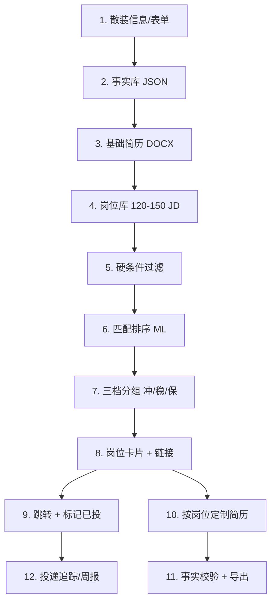

# 03 需求落地：散装信息 → 模板简历 → 三档岗位链接

> 依据：你 2026-11-23 的最新描述 + `01_要求解读与方案分析.md` + `02_ML方案与投递设计.md` + 课程评分标准。
> 一句话结论：**需求成立，「找岗位」正好是 ML 检索排序的落点；但必须改三处，否则会退化成「简历生成器 + 链接列表」，ML 20 分和 Agent 20 分都危险。**

---

## 0. 三处必须改

### 0.1 简历：基础版 + 按岗位定制版

你现在的描述是「输入信息 → 生成一份简历 → 找岗位」。问题是：**一份简历投所有岗位，正是你想解决的那个痛点。** 如果 Agent 只产出一版通用简历，它和 Word 模板没有本质区别。

改成两段式：

```
散装信息 → 事实库 → 基础简历（用于浏览岗位、投递前预览）
                          ↓
                    选中岗位 → 定制简历（重排、换关键词、STAR 化）→ 导出
```

- **基础简历**：完整、真实、一页，覆盖所有经历，用于「先有一份能看的简历」。
- **定制简历**：针对某个 JD，调整 bullet 顺序、补充 JD 关键词、把相关项目前置；**只重组事实，不新增事实**。
- 两版都保留，可对比、可回滚。

这一步同时解决三个评分点：Agent 的多步骤流程、生成的可评估性、真实性安全。

### 0.2 「投递」不能止于跳转

你的流程最后是「点击链接跳转」。严格说，这是**岗位发现与跳转**，不是投递。评审看到「投递 Agent」却只跳链接，会质疑题目与实现不符。

两个选择：

**A. 保留「投递」，补齐投递辅助（推荐）**

在跳转前后加四个轻量动作：

1. 一键复制打招呼语（针对 BOSS 等直聊平台）；
2. 导出该岗位的定制简历；
3. 点击「标记已投」，记录时间、渠道、岗位；
4. 7 天后跟进提醒 + 投递漏斗（投了多少 / 回复多少 / 面试多少）。

这样「投递」= 投递决策 + 投递资产 + 投递执行辅助 + 投递追踪，真实提交仍由你在平台完成。

**B. 改名，不叫「投递」**

改成《面向应届生的简历生成与岗位匹配 Agent》。更准确，但会丢掉你题目里的「投递」二字。

**建议选 A。** 四个动作加起来不到 1 天，但让题目站得住，也让 Agent 的「工具/状态/人工确认」有内容可写。

### 0.3 岗位链接是最大工程风险

「点开就能跳转」听起来简单，实际有三个坑：

1. **深链会失效**：具体岗位页可能下架、改 URL、需要登录；
2. **平台反爬/登录墙**：BOSS、领英、牛客的岗位页大多需要登录，不能稳定抓取；
3. **实时搜索不可复现**：演示当天搜不到，或者结果和报告不一致。

**做法：静态链接库 + 三级兜底 + 核验时间。**

```
岗位深链（job.url）
  → 公司招聘主页（company.career_url）
    → 平台搜索页（search_url，带关键词）
```

每个链接记录 `link_status`（ok / login_required / dead / unknown）和 `last_checked`，UI 上显示「最后核验 11/26」。演示前手动核验一遍；失效就走兜底，并在报告里写「链接有效率」。

**不要做实时爬虫。** 课程项目里，稳定可复现比「实时」重要得多；爬登录页还可能违反平台协议。

### 0.4 一句话定位

> **把散装经历变成一份可投的简历，把海量岗位变成三档可执行的投递清单，并告诉你每个岗位「为什么适合 / 差什么」。**

---

## 1. 你的流程 vs 评分标准

| 你的步骤 | 对应评分项 | 现在有什么 | 缺什么 | 补法 |
|---|---|---|---|---|
| 散装信息输入 | 需求 15 / Agent 20 | 真实痛点 | 结构化采集、隐私处理 | 表单 + 粘贴解析 + 事实库 |
| 按模板生成简历 | Agent 20 / Skills 15 | 有模板 | 事实校验、一页控制、ATS | 模板引擎 + LLM 改写 + 校验 |
| 帮我找岗位 | **ML 20 / 实验 20** | **没有 ML** | 检索、排序、指标 | 简历–JD 匹配排序（M1） |
| 大/中/小厂三档 | Agent 20 | 没有分层 | 分层标准、免责声明 | 公司表 + 规则分层 |
| 点击链接跳转 | 工具/数据 15 | 没有链接库 | 有效性、兜底 | 静态链接库 + 核验 |
| 投递完成 | 任务结果 | 没有追踪 | 状态记录 | 标记已投 + 漏斗 |

**最危险的一行是第三行。** 你描述的流程里，Agent 只是「套模板 + 查列表」，机器学习没有位置。必须把「匹配排序」插进「找岗位」这一步：**不是把所有岗位列出来，而是按你与岗位的匹配度排序，再分三档呈现。**

---

## 2. 推荐流程 v2



| 步骤 | 做什么 | 关键设计 | 失败处理 |
|---|---|---|---|
| 1 采集 | 表单 + 粘贴散装文本 | LLM 只做抽取，不做创作 | 字段缺失 → 标红待补 |
| 2 事实库 | 每条经历一个 `fact_id` | 后续所有生成都引用 fact_id | 无事实 → 不生成 |
| 3 基础简历 | 模板填充 + 一页控制 | LLM 只改写 bullet，不排版 | 模板缺占位符 → 报错 |
| 4 岗位库 | 120–150 条 JD | 30–40 条带可点击链接 | 数据不足 → 缩小方向 |
| 5 过滤 | 城市/方向/学历/毕业年份 | 硬条件不满足直接排除 | 全被过滤 → 放宽提示 |
| 6 排序 | ML 匹配分 + 证据 | 结构化画像做特征，不用生成文本 | 低置信度 → 转人工 |
| 7 分组 | 大/中/小 + 冲/稳/保 | 分层是策略，不是质量 | 某档为空 → 说明原因 |
| 8 卡片 | 分数、匹配/缺失技能、链接 | 显示链接核验时间 | 链接失效 → 兜底 |
| 9 跳转 | 新标签打开 + 标记已投 | 不自动提交 | 用户未标记 → 提醒 |
| 10 定制 | 按 JD 重排/改写 | 只重组事实 | 超一页 → 自动裁剪 |
| 11 校验 | 数字/公司/时间回查 | 不通过则拦截 | 回退基础版 |
| 12 追踪 | 状态、漏斗、跟进 | 本地 SQLite | 数据丢失 → 导出 CSV |

---

## 3. 模块设计

### 3.1 信息采集：表单 + 粘贴 + 确认

不要做成一上来就自由聊天。聊天会漏字段、难评估、难复现。推荐：

```
左侧：结构化表单（必填项 + 选填项）
右侧：大文本框「把散装信息粘贴进来」
      → 点「解析」→ LLM 按 JSON Schema 抽取 → 回填表单 → 用户逐项确认
```

**表单分区**：

| 分区 | 字段 | 必填 |
|---|---|---|
| 基本信息 | 姓名、手机、邮箱、所在城市、求职意向、期望城市 | 是 |
| 政治面貌 | 是否展示、面貌（党员/预备/团员/群众） | **否，默认不展示** |
| 教育 | 学校、学历、专业、起止时间、GPA/排名、核心课程 | 是（课程选填） |
| 技能 | 工具/语言/证书、熟练度、证据来源 | 是 |
| 实习 | 公司、岗位、时间、职责、量化成果 | 至少 1 段 |
| 项目 | 名称、角色、时间、技术、成果 | 至少 1 个 |
| 竞赛 | 名称、级别、奖项、时间、角色 | 选填 |
| 校园 | 社团/学生工作、时间、职责 | 选填 |

**设计要点**：

- **政治面貌是敏感字段**：默认不展示，让用户勾选「是否在简历中展示」；调用外部 LLM 前可脱敏，或只本地处理。互联网公司通常不看，国企/体制内可能看。
- **核心课程不要全列**：只保留与目标岗位相关的 5–8 门，并映射成技能（见 3.2）。
- **完整性评分**：必填项缺失时显示「还差 3 项，补齐后生成更准确」，而不是直接报错。
- **LLM 只抽取，不补全**：未知字段返回 `null`，不允许猜。

### 3.2 事实库：每条经历一个 `fact_id`

这是整个系统最重要的设计。**生成的每一句话，都必须能追到一条事实。**

```json
{
  "fact_id": "int_01_b2",
  "type": "internship",
  "org": "某电商公司",
  "role": "数据分析实习生",
  "start": "2026-03",
  "end": "2026-08",
  "text": "负责用户增长活动的数据复盘，用 SQL 取数并输出周报",
  "metrics": {"活动数": "12", "周报数": "20"},
  "source": "user_input"
}
```

- 简历里的每条 bullet 存 `fact_ids`；
- 改写后如果出现原文没有的数字、公司、时间、工具，事实校验拦截；
- UI 上每条 bullet 旁显示「依据：实习 1 / 项目 2」，用户可点开核对。

**课程 → 技能映射**（提升匹配效果，也是加分点）：

| 课程 | 可映射技能 |
|---|---|
| 数据库原理 | SQL、数据建模 |
| 统计学 / 计量经济学 | 假设检验、回归、AB 测试 |
| 机器学习 | Python、sklearn、特征工程 |
| 数据可视化 | Tableau / Power BI / Excel |
| 市场调研 | 问卷设计、用户访谈 |

这张表放在 `data/skills/course_skill_map.csv`，既是数据资产，也能在报告里说明「课程如何支撑匹配」。

### 3.3 简历模板与生成

#### 模板要求

- **必须是 DOCX**，单栏、无文本框、无复杂浮动对象；标题用标准 Heading 样式；
- 占位符：`{{basic.name}}`、`{{edu.school}}`、`{{#each internships}}...{{/each}}`；
- 每个区块有**内容预算**（例如：实习 3 条 bullet、每条 ≤60 字、项目 2 条），生成时按预算裁剪；
- 如果只有 PDF/图片模板：需要先在 Word 里重建，否则无法稳定填充。**这一步要提前做，不要留到演示前。**

#### 生成流水线

```
事实库
  → 规则：选哪些经历、什么顺序、每段几条 bullet
  → LLM：只输出 bullet 文本（JSON），不输出排版
  → 事实校验：数字/公司/时间/工具回查
  → 模板引擎：填充 DOCX
  → 导出 PDF + ATS 解析检查
```

**为什么不让 LLM 直接写整份简历**：

- 排版会丢（字体、表格、页边距）；
- 容易编造（补不存在的实习、夸大数字）；
- 无法逐条评估；
- 改一个岗位就要重写全文，成本和延迟都高。

**LLM 只做「受约束的 bullet 改写」**，模板引擎负责排版，事实库负责真实性。这个分工本身就是报告里可以写的设计选择。

#### 基础版 vs 定制版

| 版本 | 用途 | 生成时机 | 改动范围 |
|---|---|---|---|
| 基础版 | 浏览岗位、投递前预览 | 信息采集后 | 全量经历，按重要度排序 |
| 定制版 | 针对某个 JD 投递 | 选中岗位后 | 重排 bullet、补关键词、相关性前置；不新增事实 |

**一页控制**：中文校招简历通常 1 页。按「教育 3 行 + 实习 3×3 行 + 项目 2×2 行 + 技能 2 行」做预算；超出时按「相关性低 → 先删」裁剪，并在 UI 提示「已为你删掉 2 条低相关 bullet」。

### 3.4 岗位库、公司分层与链接

#### 数据规模（关键）

| 数据 | 数量 | 用途 |
|---|---|---|
| JD 语料 | **120–150 条** | ML 训练/评估、排序候选 |
| 带链接岗位 | **30–40 条** | 三档展示、点击跳转 |
| 公司 | **20–30 家** | 分层、招聘主页 |
| 简历 | 6–8 份 | query、标注 |
| 标注对 | 100–150 对 | 排序实验 |

**重要**：ML 语料和「带链接的演示集」可以分开。120 条 JD 不必都有链接；30–40 条有链接的岗位足够撑起三档展示。这样链接采集量从 120 条降到 30–40 条，工作量少一大半。

#### 公司分层表 `companies.csv`

```csv
company_id,name,tier,industry,size_stage,city,career_url,tier_reason,verified_at
c001,某头部互联网公司,大厂,互联网,万人以上,北京,https://...,校招规模大/竞争激烈,2026-11-24
c002,某垂直领域上市公司,中厂,电商,数千人,上海,https://...,细分领域知名,2026-11-24
c003,某本地 SaaS 创业公司,小厂,企业服务,数百人,杭州,https://...,成长型/竞争相对小,2026-11-24
```

**分层标准（写进报告，避免被质疑）**：

- **大厂**：校招规模大、品牌知名度高、公开营收/市值/员工规模处于头部，竞争激烈 → 对应「冲刺」；
- **中厂**：细分领域知名、上市公司/独角兽/数千人规模 → 对应「匹配」；
- **小厂**：初创/中小型/地方企业，招聘流程短、竞争相对小 → 对应「保底」。

**必须加免责声明**：

> 分层是课程项目为投递节奏做的**主观划分**，依据校招规模、品牌知名度、公开规模信息，不代表公司优劣，也不构成求职建议。

#### 岗位表 `jobs.jsonl`

```json
{"job_id":"j001","company_id":"c001","title":"数据分析师（校招）","family":"数据分析","city":"北京","salary":"20-35K","education":"本科","graduation_year":2026,"raw_text":"...","url":"https://...","career_url":"https://...","search_url":"https://...","link_status":"ok","last_checked":"2026-11-24","source":"公司校招官网"}
```

#### 链接策略

| 优先级 | 字段 | 说明 | 风险 |
|---|---|---|---|
| 1 | `url` | 具体岗位深链 | 可能失效/需登录 |
| 2 | `career_url` | 公司招聘主页 | 稳定，但需用户再找岗位 |
| 3 | `search_url` | 平台搜索页（关键词+城市） | 最稳，但需登录/结果会变 |

- UI 上主按钮「去投递」用 `url`；失效时自动切 `career_url`；再不行给 `search_url`。
- 显示「最后核验：11/26」；`login_required` 的链接加「需登录」标签。
- 演示前手动核验 30–40 条，记录 `link_status`；报告里算「链接有效率」。
- **不要实时爬取**；静态库 + 核验 + 兜底，才可复现。

#### 分层不是 ML

公司分层是**规则/人工表**，不是机器学习。报告里要明确写：

> 分层依据公司规模、校招知名度等公开信息人工标注，属于业务规则；机器学习的核心是简历–岗位匹配排序（第 3.5 节）。

这样既诚实，也避免评审追问「你的分层模型指标呢」。

### 3.5 匹配排序 ML（核心，20 分）

#### 任务

给定结构化简历画像 $r$ 与岗位 $j$，输出匹配分 $\hat{y}\in[0,1]$ 和相关性等级，并排序。

**为什么用结构化画像而不是生成后的简历文本**：避免「生成文本 → 再解析」的循环误差；结构化字段更稳定、可解释。

#### 特征

| 类别 | 特征 |
|---|---|
| 技能 | must-have 覆盖率、nice-to-have 覆盖率、技能 Jaccard |
| 课程 | 课程→技能映射后的覆盖率（如数据库→SQL） |
| 语义 | BGE 向量余弦（实习/项目描述 vs JD 要求） |
| 硬性 | 学历、专业、毕业年份、城市、到岗时间 |
| 经历 | 相关实习月数、项目相关度、竞赛级别 |
| 质量 | 量化 bullet 比例、简历完整度 |
| 岗位 | JD 长度、must-have 数量 |

#### 模型

- 主模型：**逻辑回归 + L2**（150 对样本，稳、可解释）；
- 对比：**LightGBM LambdaRank**（验证排序学习是否更好）；
- 基线：BM25、TF-IDF 余弦、BGE 余弦；
- 验证：**留一简历交叉验证**，报告均值 ± 标准差；
- 校准：Platt/isotonic，分数才能当置信度。

#### 指标

NDCG@5、NDCG@10、Recall@5、MRR；辅以人工偏好。

#### 消融

| 消融 | 验证 |
|---|---|
| − 技能特征 | 技能词典的贡献 |
| − 课程映射 | 课程→技能映射的贡献 |
| − BGE | 语义表示的贡献 |
| − 学习排序（仅 BM25） | ML 模型的净贡献 |
| − 硬性规则特征 | 结构化条件的贡献 |

#### 展示

- 分数用「匹配分 0–100（相对排序，不是录取率）」，避免虚假精确；
- 每条推荐给「匹配技能（绿）/ 缺失技能（红）/ 硬性条件（勾叉）」；
- 中间分数显示「证据不足，建议人工判断」。

#### 分层感知的排序实验（可选，但很加分）

你要求「三档呈现」，这本身可以做一个实验：

- **全局 Top-12** vs **每档 Top-4**；
- 指标：平均相关性、NDCG、档位覆盖率、人工偏好；
- 结论可能是「分层提升了覆盖率，但平均相关性略降」——这就是有价值的 trade-off。

### 3.6 三档呈现：分层是策略，匹配是契合

这是最容易被误解的地方：**大厂不等于适合你，小厂也不等于保底。** 分层回答的是「竞争强度/投递节奏」，匹配分回答的是「你与岗位的契合度」。

推荐 UI：

```
[冲刺 · 大厂]  [匹配 · 中厂]  [保底 · 小厂]
   5 个岗位        5 个岗位        5 个岗位
```

每个岗位卡片：

```
某公司 · 数据分析师（校招） · 北京 · 20-35K
匹配分 82  |  匹配：SQL、Python、AB 测试  |  缺失：Tableau
[去投递]  [标记已投]  [查看差距]  [定制简历]
链接最后核验：2026-11-26
```

- 同一档内按匹配分降序；
- 不隐藏「大厂低匹配」的岗位，但标「高竞争 / 匹配度偏低」；
- 某档为空时说明原因（如「你的城市偏好下暂无小厂岗位」），不要空白；
- 卡片上写清「分层依据」入口，避免争议。

### 3.7 投递追踪：让「投递」站得住

| 功能 | 实现 | 评估 |
|---|---|---|
| 标记已投 | 按钮 + 时间戳 + 渠道 | 记录完整率 |
| 状态流转 | 已投 → 笔试 → 面试 → 拒绝/Offer | 状态一致性 |
| 跟进提醒 | 7 天未回复提醒 | 提醒触达率 |
| 漏斗 | 按档位/方向统计投递数、回复数 | 可展示 |
| 导出 | CSV | 可复现 |

**不要做真实自动提交**；如果时间富余，做一个本地 mock 平台演示「提交」动作即可，但优先级低于前面的核心闭环。

### 3.8 UI 页面（Streamlit 五页）

1. **信息采集**：表单 + 粘贴解析 + 完整性评分；
2. **简历预览**：模板渲染预览、缺失项提示、下载 DOCX/PDF；
3. **岗位推荐**：三档 tabs + 筛选（城市/方向）+ 卡片；
4. **岗位详情**：匹配证据、差距、定制简历、打招呼语、链接；
5. **投递追踪**：表格/看板、漏斗、跟进提醒。

Streamlit 实现提示：

- `st.link_button("去投递", url)` 打开新标签；
- 外部链接点击无法直接回调，所以用「标记已投」按钮记录；
- DOCX 预览可用 HTML 简版；PDF 转换可选 LibreOffice headless（`soffice --headless --convert-to pdf`），没有就只提供 DOCX 下载并说明。

---

## 4. 数据结构

### 4.1 `profile.json`

```json
{
  "basic": {"name": "张三", "phone": "138****", "email": "***@***.com", "city": "上海", "political_status": null, "show_political": false, "job_intent": ["数据分析"], "target_cities": ["上海", "杭州"]},
  "education": [{"school": "某211", "school_tier": "211", "degree": "本科", "major": "信息管理", "start": "2022-09", "end": "2026-06", "gpa": "3.6/4.0", "courses": ["数据库原理", "统计学", "机器学习"]}],
  "skills": [{"name": "SQL", "level": "熟练", "evidence": "课程+实习"}],
  "internships": [{"company": "某电商", "role": "数据分析", "start": "2026-03", "end": "2026-08", "bullets": [{"text": "...", "fact_id": "int_01_b2"}]}],
  "projects": [],
  "competitions": [],
  "campus": [],
  "certificates": []
}
```

### 4.2 `companies.csv`

见 3.4。

### 4.3 `jobs.jsonl`

见 3.4。

### 4.4 `applications.csv`

```csv
app_id,job_id,company,tier,status,applied_at,channel,resume_version,note
a001,j001,某公司,大厂,已投,2026-11-26,BOSS,v2,...
```

### 4.5 `sources.md`

每条 JD/简历/链接一行：来源 URL、采集日期、许可证/使用边界、是否脱敏。

---

## 5. 实验设计（针对新流程）

### 5.1 排序（主实验，20 分核心）

- 100–150 对标注，0–3 分；
- 5 基线 + 4 消融 + 留一简历交叉验证；
- NDCG@5/10、Recall@5、MRR；
- 错误分析六类：数据/表示/模型/提示词/工具/任务设计。

### 5.2 简历生成（证明 Agent 有用）

| 指标 | 做法 | 目标 |
|---|---|---|
| 事实错误率 | 50 条生成 bullet，人工标「支持/部分/不支持」 | ≤2% |
| 模板完整率 | 所有占位符是否填充 | 100% |
| 一页率 | 导出 PDF 数页数 | ≥90% |
| ATS 可解析率 | pdfplumber 抽取字段 | ≥90% |
| 人工偏好 | 10 个岗位，基础版 vs 定制版盲评 | 定制版胜率 ≥60% |
| 耗时 | 3 次计时 | ≤10 分钟/份 |

### 5.3 链接（工程证据）

- 30–40 条链接，核验 `ok / login_required / dead`；
- 指标：链接有效率、兜底成功率、核验耗时；
- 报告里写「链接有时效性，已在 11/26 核验」。

### 5.4 分层（回应你的三档需求）

- 每档 ≥8 个岗位，展示每档 Top-5；
- 3 位同学对「档位是否合理」打分（1–5），报告一致性；
- 全局 Top-12 vs 每档 Top-4 的相关性/覆盖率对比。

### 5.5 端到端

5 个任务：输入信息 → 基础简历 → 推荐 → 点链接 → 标记已投；记录完成率、耗时、卡点。

---

## 6. 四天计划（按新流程）

| 时间 | 任务 | 必须落盘 |
|---|---|---|
| **11/23 晚（4–5h）** | 定模板占位符；采集 20 JD + 10 公司 + 10 链接；2 人访谈；rubric + 10 对标注 | `template.docx`、`jd.jsonl`、`companies.csv`、`rubric.md` |
| **11/24（8h）** | 信息采集表单 + 事实库 + 基础简历生成；JD 到 80；链接到 20；标注到 80 对 | 可生成一份基础简历；`pairs.csv` 80 行 |
| **11/25（8h）** | 特征 + BM25/TF-IDF/BGE 基线 + LR；三档 UI + 链接卡片 | 排序 Demo + 三档页面 |
| **11/26（8h）** | 定制简历 + 事实校验；JD 到 120–150；链接到 30–40；消融；录屏 | 端到端可演示、消融表、录屏 |
| **11/27（8h）** | 补实验/图；报告 3000–5000 字；PDF；README；许可证附录；提交 | 四项材料 |

**砍功能顺序**：

```
mock 提交 → 投递组合优化 → JD 聚类 → 渠道推荐 → 第三档之外的城市 → UI 美化
```

**绝不砍**：信息采集 → 基础简历 → 匹配排序 → 三档链接 → 标记已投 → 排序实验 → 事实校验 → README。

---

## 7. 风险与降级

| 风险 | 概率 | 影响 | 规避 | 降级 |
|---|---|---|---|---|
| 链接失效/需登录 | 高 | 高 | 静态库 + 三级兜底 + 演示前核验 | 改公司招聘主页 |
| 模板是 PDF/图片 | 中 | 高 | 提前重建成 DOCX | 用内置 ATS 模板 |
| JD/简历不够 | 中 | 高 | 今晚开始采；数据集批量补 | 80 JD / 5 简历 / 60 对 |
| LLM 编造 | 中 | 高 | 事实库 + 规则/LLM 双校验 | 只允许模板句 |
| 政治面貌等隐私 | 中 | 高 | 默认不展示；脱敏；本地存储 | 不采集 |
| 分层争议 | 中 | 中 | 标准 + 免责声明 + 三档都展示 | 改叫「冲刺/匹配/保底」 |
| 4 天做不完 | 高 | 高 | 按砍功能顺序 | 保排序 + 简历 + 三档链接 + 报告 |
| 报告来不及 | 中 | 高 | 11/26 出初稿 | 先交原型 + 实验表 |

---

## 8. 更好的建议（按重要性排序）

1. **基础版 + 定制版**：一份通用简历投所有岗位，正是你要解决的痛点；不做定制，项目价值减半。
2. **事实库 + 证据链**：每条 bullet 可追溯到 `fact_id`，这是防幻觉、做评估、写报告三条线同时受益的设计。
3. **分层和匹配分开**：分层是投递策略（冲/稳/保），匹配是契合度；不要把「大厂」当成「适合」。
4. **链接三级兜底**：深链 → 公司主页 → 搜索页；显示核验时间；不做实时爬虫。
5. **标记已投 + 周报**：四个小动作让「投递」站得住，也让 Agent 有状态可展示。
6. **ML 语料和链接演示集分开**：120 条 JD 做实验，30–40 条带链接做展示，采集量减半。
7. **LLM 不排版**：模板引擎负责格式，LLM 只写 bullet；格式稳定、可评估、可回滚。
8. **课程→技能映射**：把「数据库原理」映射成 SQL，把「统计学」映射成 AB 测试；这是你的数据资产，也是匹配效果的来源。
9. **分层感知排序实验**：全局 Top-12 vs 每档 Top-4，证明三档展示的 trade-off，而不是拍脑袋。
10. **ATS 解析检查**：导出 PDF 再解析，证明「这份简历招聘系统读得懂」；这是很容易被忽略的加分项。
11. **敏感字段默认关闭**：政治面貌、手机、邮箱默认脱敏/不展示；报告里写隐私处理。
12. **标题保留「投递」，但定义为「投递决策与执行辅助」**：既不丢题目，也不过度承诺。

---

## 9. 开工前需要你提供的 4 样东西

1. **简历模板**：优先 DOCX；如果是 PDF/图片，告诉我，我帮你重建成可填充的 DOCX。
2. **目标岗位方向 + 城市**：例如「数据分析 / 产品运营，上海 + 杭州」；决定 JD 采集和公司名单。
3. **30–40 家公司名单**（或授权我按方向拟一份）：每档 8–12 家，附招聘主页（有就給，没有我帮你找）。
4. **6–8 份简历素材**：至少你自己的；同学的需要一句授权（脱敏后仅本地实验）。

另外确认：**DeepSeek/OpenAI API key 是否可用**；如果只能用本地模型，改写质量会下降，需要更多模板兜底。

---

## 10. 标题与定位

推荐标题：

> **《面向应届生的简历生成与投递决策 Agent》**

备选：

- 《散装经历 → 可投简历 → 三档岗位：大学生求职助手》
- 《人岗匹配驱动的简历定制与岗位推荐 Agent》

报告里第一段就写清边界：

> 本系统完成「信息整理 → 简历生成 → 岗位匹配 → 分层推荐 → 跳转与追踪」的闭环；真实平台提交由用户完成，原因是平台协议、账号安全与隐私边界。机器学习核心是简历–岗位匹配排序，简历生成采用模板引擎 + 受约束的 LLM 改写，公司分层为人工规则。
